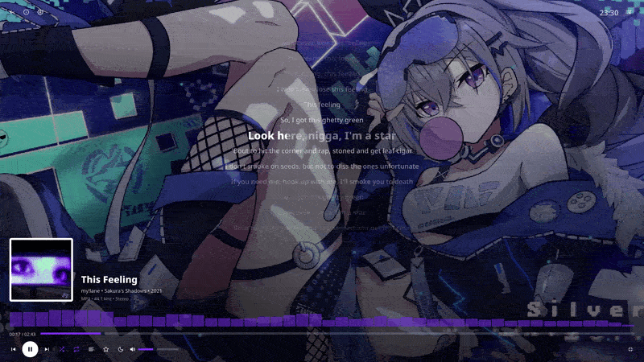
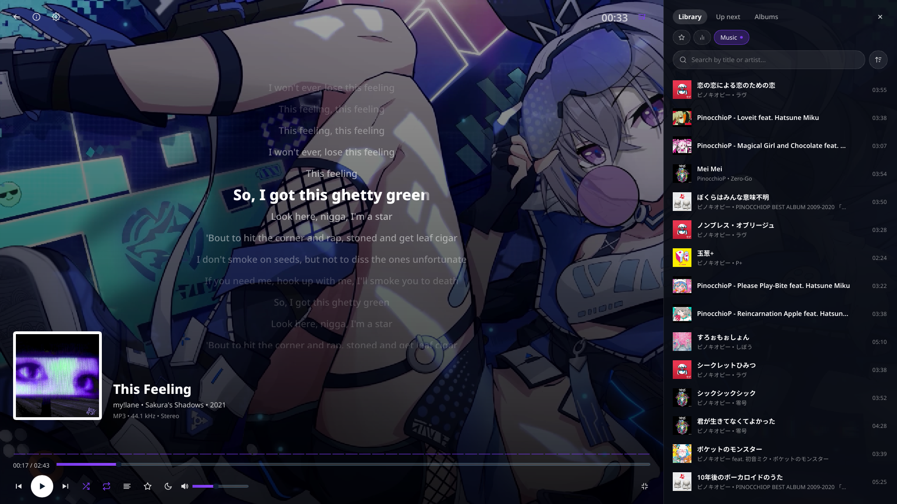
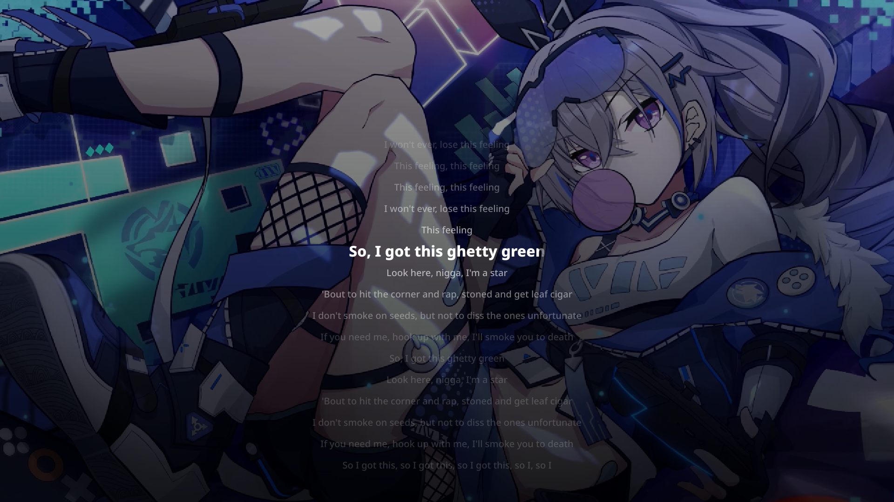
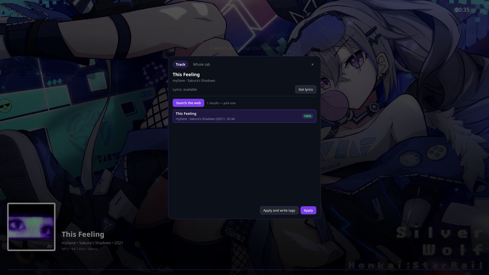
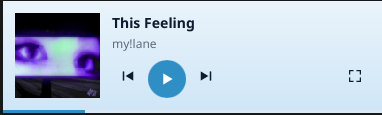

<div align="center">


# Furinar

**A light, fast, and beautiful audio player — inspired by the Hydro Archon.**


🇺🇸 English | [🇧🇷 Português](README.pt-BR.md)

</div>

---

<div align="center">


</div>

## Why Furinar?

Most desktop music players ship an entire browser engine just to play an MP3. Furinar does the opposite: it's a native Rust binary that opens in milliseconds and uses **about 12 MB of RAM idle and 20 MB while playing** — less than an idle browser tab.

It isn't minimal at the cost of features, though: gapless playback and crossfade, ReplayGain, synced lyrics (even karaoke-style), a fullscreen mode with animated backgrounds and a visualizer, web track identification, and scrobbling. The heavy parts only exist while in use: leaving fullscreen or finishing a web lookup gives the memory back.

The palette — deep navy, cyan, and gold (or baby blue and pearl white in light mode) — is a tribute to **Furina**, from *Genshin Impact*. A fan project with no official affiliation with HoYoverse.

## ✨ Features

### Playback
- MP3, WAV, FLAC, OGG/Vorbis, and M4A
- Videos as tracks: MP4/MOV/M4V play natively; MKV/WebM/AVI need `ffmpeg` on the PATH. The normal window plays just the audio; in the immersive mode the video itself fills the background, in sync with the music
- Always **gapless**, plus optional **crossfade** of 3, 6 or 10 s — consecutive tracks from the same album join without crossfading, so live albums stay intact
- **ReplayGain**: uses the gain stored in the tags so every track plays at the same loudness
- Loop (off / track / list) and two shuffles: **smart** (every track once before repeating) and **random**; "previous" in shuffle goes back to what actually played
- **"Up next"** queue showing exactly what will play, shuffle included
- **Sleep timer** (15/30/60 min or end of track), fading the volume out
- On reopen, comes back paused on the last track, at the same position, with the same queue

### Library
- **Multiple folders as tabs** — switching tabs never interrupts playback
- ID3/Vorbis/MP4 tags (title, artist, album, number, duration), optional subfolders
- Search by title and artist, accent- and case-insensitive
- **Per-tab sorting**: title, artist, album, duration, recently added or most played
- **Favorites** (star or `F`) and **Most played**, fixed tabs gathering tracks from every folder

### Lyrics
- `.lrc` next to the track, scrolling with the music — click a line to jump there
- Lyrics embedded in the tags (SYLT, USLT, LYRICS) when there's no `.lrc`
- **Karaoke-style** in fullscreen: the current line fills as it's sung (word by word with enhanced LRC, `<mm:ss.xx>`)
- Optional download from [LRCLIB](https://lrclib.net) for tracks without lyrics

<div align="center">


</div>

### Immersive mode (fullscreen)
Fullscreen button, `F11` or `furinar --imersivo`.
- Cover, artist, album, year and technical details, with the **accent color taken from the cover**
- **Custom backgrounds**: image, animated GIF/WebP or video (mp4/webm/mkv/mov/avi, through the system `ffmpeg`). Several backgrounds rotate per track. No background? The blurred cover takes over
- **Spectrum visualizer** and a background that pulses with the bass (optional — uses more CPU)
- **Library drawer** (`L`): tabs, search (`/`), list with thumbnails, "up next" queue and an **album grid** — clicking an album opens it in a tab and starts playing
- "Up next" notice in the last 10 s, lyrics-only view (`H`), clock, and settings without leaving fullscreen
- Controls hide when the mouse stops; cover and visualizer move down to the bottom of the screen

<div align="center">



<table>
  <tr>
    <td align="center"><b>Library drawer</b></td>
    <td align="center"><b>Lyrics only (H)</b></td>
  </tr>
  <tr>
    <td></td>
    <td></td>
  </tr>
</table>

</div>

### Web metadata
Track info screen (`I`):
- Identifies the track on [MusicBrainz](https://musicbrainz.org) by name — or **by sound**, with a free [AcoustID](https://acoustid.org) key
- Shows the candidates with a confidence score; you apply the right one
- Downloads cover art from the [Cover Art Archive](https://coverartarchive.org) when the track and folder have none
- **Indexes a whole tab**: matches of 90% or more are applied automatically, the rest waits for your review
- Fixes stay in Furinar. They only go into your files' tags if you ask (with confirmation), and "Restore original" undoes them

<div align="center">



</div>

### Integrations
- **Discord**: "Listening to …" on your profile, with cover art and a progress bar
- **Scrobbling** to [ListenBrainz](https://listenbrainz.org) and [Last.fm](https://www.last.fm), queued while offline
- System media controls: MPRIS on Linux, SMTC on Windows (media keys, action center)
- Windows: previous/play/next on the taskbar thumbnail and rounded corners on Windows 11

### Window
- **Mini player** (`M`): the window shrinks into a bar with cover and controls, always on top on Windows and X11. On Wayland apps can't request it; on GNOME, use `Alt+Space` → "Always on Top"
- Light and dark themes, switched instantly; Portuguese and English
- Custom title bar, frameless (drag to move, Aero Snap)

<div align="center">



</div>


<div align="center">
  <table>
    <tr>
      <td align="center"><b>Light theme</b></td>
      <td align="center"><b>Dark theme</b></td>
    </tr>
    <tr>
      <td></td>
      <td></td>
    </tr>
  </table>
</div>

## ⌨️ Shortcuts

| Key | Action |
|---|---|
| `Space` | Play / pause |
| `←` `→` | Seek back / forward 5 s |
| `↑` `↓` `Enter` | Move through the list and play the selected track |
| `F` | Favorite the current track |
| `I` | Track info (web lookup) |
| `M` | Mini player |
| `F11` | Immersive mode |
| `Esc` | Closes whatever is open; in immersive mode, layer by layer until it leaves |
| `L` / `/` | Immersive: library drawer / search |
| `H` | Immersive: lyrics only |

## 🚀 Installation

### Windows
1. Download `furinar-windows-x86_64-setup.exe` from the [Releases](https://github.com/LokKol17/furinar/releases) page and run it. It installs for your user only (no admin prompt), adds Furinar to the Start menu and shows up in **Settings → Apps** to uninstall.
2. Open Furinar and click **Open folder** to point it at your music.
3. Furinar remembers everything next time, and tells you when a new version is out (updating is one click).

Settings live in `%APPDATA%\Furinar`. Prefer no installation? Grab `furinar-windows-x86_64.exe` instead and just run it. To keep it fully portable (settings next to the `.exe`, e.g. on a USB stick), create an empty `furinar_config.json` beside it.

### Linux

**Universal installer** (installs for your user in `~/.local`, no sudo unless system libraries are missing; Furinar then updates itself from inside the app):

```bash
curl -fsSL https://raw.githubusercontent.com/LokKol17/furinar/master/pkg/install.sh | bash
```

**From source:**

```bash
git clone https://github.com/LokKol17/furinar.git
cd furinar
make tarball
cd dist/furinar-*/
./install.sh --from-source
```

**Native packages:**

| Distro | Command |
|---|---|
| Debian/Ubuntu | `make deb && sudo dpkg -i dist/furinar_*_amd64.deb` |
| Fedora | `make rpm && sudo rpm -i dist/rpm/RPMS/x86_64/*.rpm` |
| Arch/Manjaro | `makepkg -si` (using `pkg/arch/PKGBUILD`) |

**System dependencies:**

| Distro | Required | Optional (videos, video backgrounds) |
|---|---|---|
| Debian/Ubuntu | `sudo apt install libasound2 libgtk-3-0` | `ffmpeg` |
| Fedora | `sudo dnf install alsa-lib gtk3` | `ffmpeg` |
| Arch/Manjaro | `sudo pacman -S alsa-lib gtk3` | `ffmpeg` |

## ⚙️ Configuration

Almost everything is set from the app itself (gear icon, in normal mode and in fullscreen).

### Fullscreen backgrounds
- **Per folder:** put `background.*` or `furinar-bg.*` in the music folder (or the tab's root). Several — `background-1.png`, `background-2.gif` — rotate.
- **Global:** pick one or more files in Settings.
- Formats: png, jpg, bmp, gif, webp; video (mp4, webm, mkv, mov, avi) needs `ffmpeg` on the PATH. Small pixel art is scaled up without blurring.

### Online services
Everything is optional and only happens when you turn it on or ask for it:

| Service | What for | What is sent | When |
|---|---|---|---|
| LRCLIB | Lyrics | title, artist, album, duration | "Fetch lyrics from the internet" on, or the "Get lyrics" button |
| MusicBrainz / Cover Art Archive | Metadata and covers | title, artist, duration | "Search the web" or "Index this tab" |
| AcoustID | Identify by sound | audio fingerprint | With your key, when the name search isn't enough |
| ListenBrainz / Last.fm | Scrobbling | tracks you listened to | With a token/account set up |
| Discord | Profile status | current track (local, through the app's IPC) | "Show what's playing on Discord" on |
| Deezer | Cover art for the Discord status | title, artist | Same option, once per track without a MusicBrainz match |
| GitHub | New version notice | — | On startup (off for package installs) |

For **Last.fm**: create an "API account" at [last.fm/api/account/create](https://www.last.fm/api/account/create), paste the key and secret in Settings, click **Connect Last.fm**, authorize in the browser, then click **Finish connecting**. For **ListenBrainz**, the token from [listenbrainz.org/settings](https://listenbrainz.org/settings/) is enough.

### Files
Stored in `~/.config/furinar/` on Linux and in `%APPDATA%\Furinar` on Windows (or next to the `.exe` in portable mode):

| File | Contents |
|---|---|
| `furinar_config.json` | Folders, options, last track and position, scrobbling accounts |
| `furinar_biblioteca.json` | Favorites and play counts |
| `furinar_metadados.json` | Fixes accepted from the web (applied over the tags) |
| `furinar_scrobbles.json` | Listens waiting for a connection to be sent |

Caches (safe to delete) live in `~/.cache/furinar/` or `%LOCALAPPDATA%\furinar\`: cover thumbnails (up to 64 MB), downloaded covers and lyrics.

The ListenBrainz token and the Last.fm secret are stored as plain text in `furinar_config.json` — treat the file as personal.

## 🛠️ For developers

<details>
<summary>Build, test and package</summary>

**Requirements:** Rust (edition 2024). On Linux: `libasound2-dev libgtk-3-dev pkg-config`.

```bash
cargo run                      # development
cargo run -- --imersivo        # start in fullscreen
cargo build --release          # optimized binary in target/release/
```

**Checks** (CI runs both variants, with zero warnings):

```bash
cargo fmt --all --check
cargo clippy --all-targets --all-features -- -D warnings
cargo clippy --all-targets --no-default-features -- -D warnings
cargo test --all-features
cargo test --no-default-features
```

Windows-only code is checked locally with `--target x86_64-pc-windows-gnu`. MPRIS is the default `mpris` feature.

**Window-less screenshots**, to check the UI:

```bash
FURINAR_CAPTURA_FAIXA=/music/track.mp3 cargo test captura_modo_normal -- --ignored
FURINAR_CAPTURA_FAIXA=/music/track.mp3 FURINAR_CAPTURA_PAINEL=1 cargo test captura_modo_imersivo -- --ignored
```

They write `target/captura-normal.png` and `target/captura-imersivo.png`. The other variables (`_CONFIG`, `_INFO`, `_MINI`, `_ALBUNS`, `_OCIOSO`...) are listed in [CLAUDE.md](CLAUDE.md).

**Real web lookup** (needs internet): `cargo test web_ao_vivo -- --ignored --nocapture`.

**Packages and release:**

```bash
make help       # all targets
make deb        # .deb (Debian/Ubuntu)
make rpm        # .rpm (Fedora)
make tarball    # tarball with installer
make release    # artifacts for GitHub Releases
```

The version comes from `Cargo.toml`; after changing it, run `make sync-version` and `make check-version`. A `vX.Y.Z` tag triggers the release workflow. The asset names (`furinar-windows-x86_64.exe`, `furinar-linux-x86_64.tar.gz`) must not change: the updater looks for them. Details in [docs/RELEASE_CONVENTION.md](docs/RELEASE_CONVENTION.md).

</details>

<details>
<summary>Code layout</summary>

- `src/main.rs` — sets the app up: loads the config, wires the callbacks and the 250 ms timer
- `estado.rs`, `listas.rs`, `reproducao.rs` — state, tabs and lists, playback (gapless, crossfade, shuffle, lyrics)
- `ponte_imersivo.rs`, `imersivo.rs`, `painel.rs`, `fundo.rs`, `visualizador.rs` — fullscreen mode
- `web_ui.rs`, `buscador.rs`, `musicbrainz.rs`, `acoustid.rs`, `letras_web.rs`, `metadados.rs` — web lookup
- `scrobble.rs`, `discord.rs`, `plataforma.rs` — integrations
- `ui/*.slint` — UI in [Slint](https://slint.dev)

Identifiers and comments are in Portuguese. [CLAUDE.md](CLAUDE.md) has the architecture in detail.

</details>

<details>
<summary>App icon</summary>

The icon lives in `ui/assets/furinar_icon.png` and doesn't need to be square: `build.rs` trims the transparent borders, centers it in a 256 px square, and generates both the window icon and the `.ico` (16/32/48/256) embedded in the Windows executable. To change it, replace the file.

</details>

## 📄 License

Source code under [BSD 3-Clause](LICENSE): use, fork and modify freely, keeping the credits and the license notice. UI built with [Slint](https://slint.dev), under the Royalty-free license. Stroke icons derived from [Feather Icons](https://feathericons.com) (MIT).

## 💙 Credits

Inspired by Furina, from *Genshin Impact* (HoYoverse). Furinar is a fan project with no official affiliation.

<a href="https://slint.dev">
    
</a>
