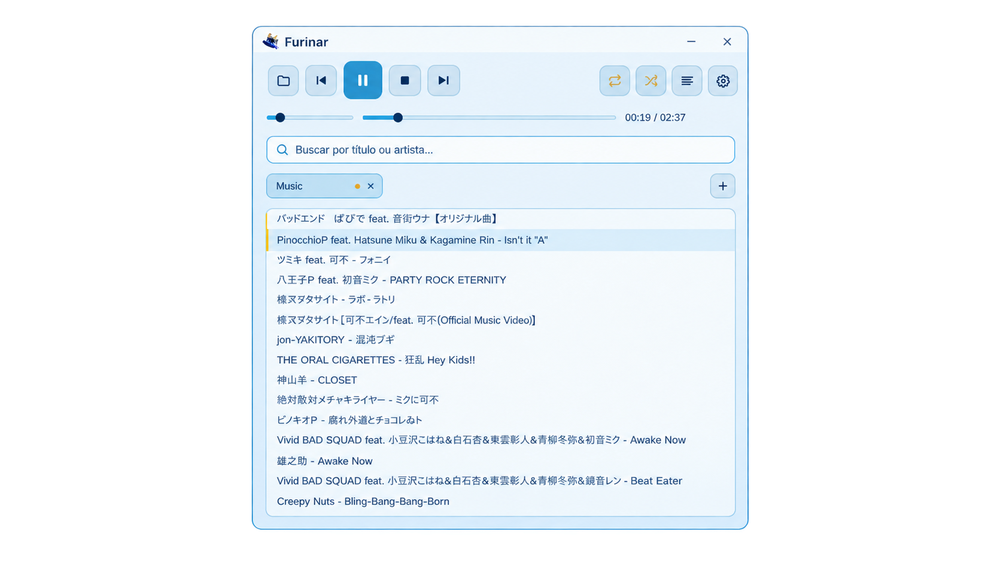
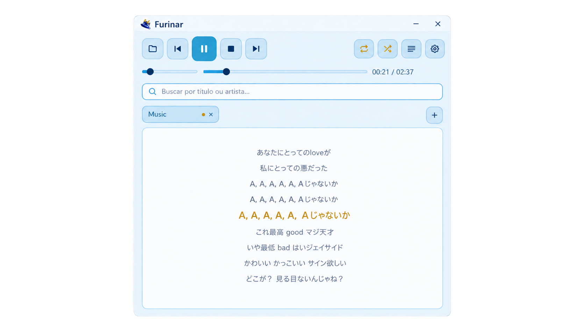
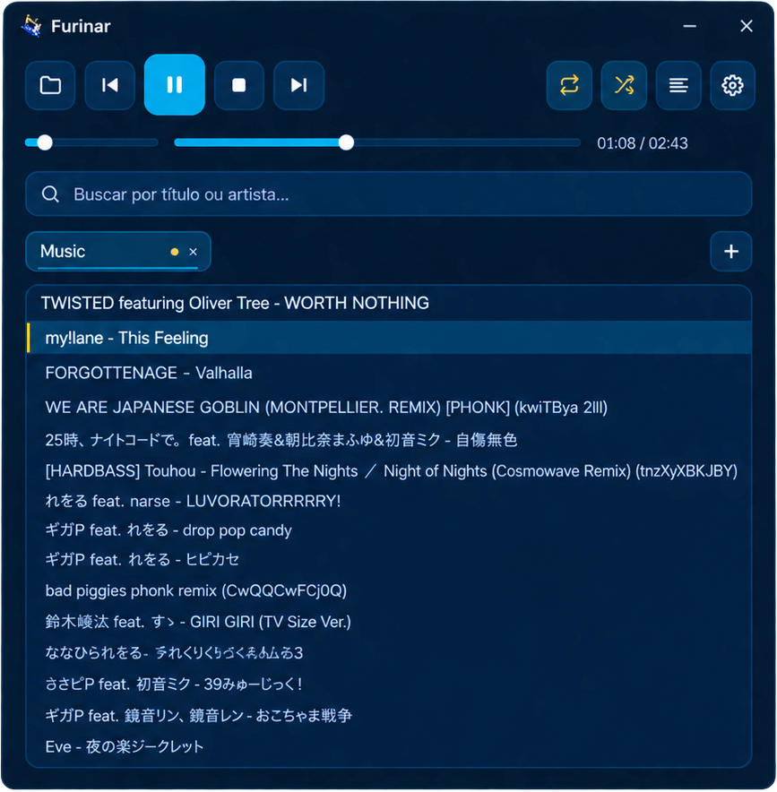

<div align="center">


# Furinar

**Um player de áudio leve, rápido e bonito — inspirado na Hydro Archon.**


[🇺🇸 English](README.md) | 🇧🇷 Português

</div>

---

<div align="center">



</div>

## Por que Furinar?

A maioria dos players de música para desktop carrega um navegador inteiro por baixo do capô só para tocar um MP3. O Furinar faz o contrário: é um binário nativo em Rust que abre em milissegundos e usa **cerca de 12 MB de RAM parado e 20 MB tocando** — menos que uma aba de navegador parada.

E não é minimalista à custa de recursos: tem gapless e crossfade, ReplayGain, letras sincronizadas (até estilo karaokê), um modo tela cheia com fundos animados e visualizador, identificação de faixas pela web e scrobble. O que é pesado só existe enquanto está em uso: sair da tela cheia ou terminar uma busca na web devolve a memória.

A paleta — azul-marinho, ciano e dourado (ou azul-bebê e branco pérola no tema claro) — é uma homenagem à **Furina**, de *Genshin Impact*. Projeto de fã, sem relação oficial com a HoYoverse.

## ✨ Funcionalidades

### Reprodução
- MP3, WAV, FLAC, OGG/Vorbis e M4A
- **Gapless** sempre, e **crossfade** opcional de 3, 6 ou 10 s — faixas seguidas do mesmo álbum emendam sem crossfade, para não estragar disco ao vivo
- **ReplayGain**: usa o ganho gravado nas tags para todas as faixas tocarem no mesmo volume
- Loop (desligado / faixa / lista) e dois shuffles: **inteligente** (cada faixa uma vez antes de repetir) e **aleatório**; "anterior" no shuffle volta ao que tocou de verdade
- Fila **"a seguir"** que mostra exatamente o que vai tocar, inclusive no shuffle
- **Temporizador de sono** (15/30/60 min ou fim da faixa), baixando o volume aos poucos
- Ao reabrir, volta pausado na última faixa, na mesma posição e com a mesma fila

### Biblioteca
- **Várias pastas em abas** — navegar entre elas não interrompe o que está tocando
- Tags ID3/Vorbis/MP4 (título, artista, álbum, número, duração), subpastas opcionais
- Busca por título e artista, sem ligar para acento e maiúscula
- **Ordenação por aba**: título, artista, álbum, duração, adicionadas recentemente ou mais tocadas
- **Favoritas** (estrela ou `F`) e **Mais tocadas**, abas fixas que juntam faixas de todas as pastas

### Letras
- `.lrc` ao lado da faixa, rolando com a música — clique numa linha para pular até ela
- Letra embutida nas tags (SYLT, USLT, LYRICS) quando não há `.lrc`
- **Estilo karaokê** na tela cheia: a linha atual enche no ritmo do canto (palavra por palavra com LRC estendido, `<mm:ss.xx>`)
- Download opcional do [LRCLIB](https://lrclib.net) para faixas sem letra

### Modo imersivo (tela cheia)
Botão de tela cheia, `F11` ou `furinar --imersivo`.
- Capa, artista, álbum, ano e detalhes técnicos, com a **cor de destaque tirada da capa**
- **Fundos personalizados**: imagem, GIF/WebP animado ou vídeo (mp4/webm/mkv/mov/avi, via `ffmpeg` do sistema). Vários fundos trocam a cada faixa. Sem fundo, a capa desfocada assume
- **Visualizador de espectro** e fundo que pulsa com os graves (opcional — usa mais CPU)
- **Painel da biblioteca** (`L`): abas, busca (`/`), lista com miniaturas, fila "a seguir" e **grade de álbuns** — clicar num álbum abre uma aba com ele e começa a tocar
- Aviso "a seguir" nos últimos 10 s, modo só letra (`H`), relógio e configurações sem sair da tela cheia
- Os controles somem quando o mouse para; capa e visualizador descem para o pé da tela

<div align="center">



</div>

### Metadados da web
Tela de informações da faixa (`I`):
- Identifica a faixa no [MusicBrainz](https://musicbrainz.org) pelo nome — ou **pelo som**, com uma chave grátis do [AcoustID](https://acoustid.org)
- Mostra os candidatos com nota de confiança; você aplica o que estiver certo
- Baixa a capa do [Cover Art Archive](https://coverartarchive.org) quando a faixa e a pasta não têm uma
- **Indexa a aba inteira**: o que tem 90% de confiança ou mais entra sozinho, o resto fica para você revisar
- As correções ficam no Furinar. Só vão para as tags dos arquivos se você pedir (com confirmação), e "Restaurar original" desfaz

### Integrações
- **Discord**: "Ouvindo …" no seu perfil, com capa e barra de progresso
- **Scrobble** no [ListenBrainz](https://listenbrainz.org) e no [Last.fm](https://www.last.fm), com fila para quando não houver internet
- Controles de mídia do sistema: MPRIS no Linux, SMTC no Windows (teclas de mídia, central de ações)
- Windows: anterior/play/próxima na miniatura da barra de tarefas e cantos arredondados no Windows 11

### Janela
- **Mini player** (`M`): a janela vira uma barra com capa e controles, sempre por cima no Windows e no X11. No Wayland o app não pode pedir isso; no GNOME, use `Alt+Espaço` → "Sempre no topo"
- Tema claro e escuro, trocados na hora; português e inglês
- Barra de título própria, sem moldura nativa (arrastar, Aero Snap)

<div align="center">
  <table>
    <tr>
      <td align="center"><b>Tema claro</b></td>
      <td align="center"><b>Tema escuro</b></td>
    </tr>
    <tr>
      <td></td>
      <td></td>
    </tr>
  </table>
</div>

## ⌨️ Atalhos

| Tecla | Ação |
|---|---|
| `Espaço` | Tocar / pausar |
| `←` `→` | Voltar / avançar 5 s |
| `↑` `↓` `Enter` | Navegar na lista e tocar a faixa selecionada |
| `F` | Favoritar a faixa atual |
| `I` | Informações da faixa (busca na web) |
| `M` | Mini player |
| `F11` | Modo imersivo |
| `Esc` | Fecha o que estiver aberto; no imersivo, em camadas até sair |
| `L` / `/` | Imersivo: painel da biblioteca / busca |
| `H` | Imersivo: só a letra |

## 🚀 Instalação

### Windows
1. Baixe o `furinar-windows-x86_64.exe` na página de [Releases](https://github.com/LokKol17/furinar/releases).
2. Abra e clique em **Abrir pasta** para apontar onde estão suas músicas.
3. O Furinar lembra tudo da próxima vez, e avisa quando sai versão nova (a atualização é um clique).

### Linux

**Instalador universal** (detecta a distro, instala as dependências e coloca o binário em `/usr/local/bin`):

```bash
curl -fsSL https://raw.githubusercontent.com/LokKol17/furinar/master/pkg/install.sh | bash
```

**A partir do código-fonte:**

```bash
git clone https://github.com/LokKol17/furinar.git
cd furinar
make tarball
cd dist/furinar-*/
sudo ./install.sh --from-source
```

**Pacotes nativos:**

| Distro | Comando |
|---|---|
| Debian/Ubuntu | `make deb && sudo dpkg -i dist/furinar_*_amd64.deb` |
| Fedora | `make rpm && sudo rpm -i dist/rpm/RPMS/x86_64/*.rpm` |
| Arch/Manjaro | `makepkg -si` (com `pkg/arch/PKGBUILD`) |

**Dependências do sistema:**

| Distro | Obrigatórias | Opcional (fundos em vídeo) |
|---|---|---|
| Debian/Ubuntu | `sudo apt install libasound2 libgtk-3-0` | `ffmpeg` |
| Fedora | `sudo dnf install alsa-lib gtk3` | `ffmpeg` |
| Arch/Manjaro | `sudo pacman -S alsa-lib gtk3` | `ffmpeg` |

## ⚙️ Configuração

Quase tudo se ajusta pela própria interface (ícone de engrenagem, no modo normal e na tela cheia).

### Fundos da tela cheia
- **Por pasta:** coloque `background.*` ou `furinar-bg.*` na pasta da música (ou na raiz da aba). Vários — `background-1.png`, `background-2.gif` — entram em rodízio.
- **Globais:** escolha um ou vários arquivos nas configurações.
- Formatos: png, jpg, bmp, gif, webp; vídeo (mp4, webm, mkv, mov, avi) precisa do `ffmpeg` no PATH. Pixel art pequena é ampliada sem borrar.

### Serviços online
Tudo é opcional e só acontece quando você liga ou pede:

| Serviço | Para quê | O que é enviado | Quando |
|---|---|---|---|
| LRCLIB | Letras | título, artista, álbum, duração | "Buscar letras na internet" ligado, ou botão "Baixar letra" |
| MusicBrainz / Cover Art Archive | Metadados e capas | título, artista, duração | Botão "Buscar na web" ou "Indexar esta aba" |
| AcoustID | Identificar pelo som | impressão digital do áudio | Com a sua chave, quando a busca pelo nome não basta |
| ListenBrainz / Last.fm | Scrobble | faixas ouvidas | Com token/conta configurados |
| Discord | Status no perfil | faixa tocando (local, pela IPC do app) | "Mostrar no Discord" ligado |
| GitHub | Avisar de versão nova | — | Ao abrir (desligado em instalações por pacote) |

Para o **Last.fm**: crie uma "API account" em [last.fm/api/account/create](https://www.last.fm/api/account/create), cole a chave e o segredo nas configurações, clique em **Conectar Last.fm**, autorize no navegador e clique em **Concluir conexão**. Para o **ListenBrainz**, basta o token de [listenbrainz.org/settings](https://listenbrainz.org/settings/).

### Arquivos
Ficam em `~/.config/furinar/` no Linux e ao lado do executável no Windows:

| Arquivo | Conteúdo |
|---|---|
| `furinar_config.json` | Pastas, opções, última faixa e posição, contas de scrobble |
| `furinar_biblioteca.json` | Favoritas e contagem de reproduções |
| `furinar_metadados.json` | Correções aceitas da web (por cima das tags) |
| `furinar_scrobbles.json` | Escutas esperando internet para serem enviadas |

Caches (podem ser apagados à vontade) em `~/.cache/furinar/` ou `%LOCALAPPDATA%\furinar\`: miniaturas de capa (até 64 MB), capas e letras baixadas.

O token do ListenBrainz e o segredo do Last.fm ficam em texto puro no `furinar_config.json` — trate o arquivo como pessoal.

## 🛠️ Para desenvolvedores

<details>
<summary>Compilar, testar e empacotar</summary>

**Requisitos:** Rust (edition 2024). No Linux: `libasound2-dev libgtk-3-dev pkg-config`.

```bash
cargo run                      # desenvolvimento
cargo run -- --imersivo        # já abre em tela cheia
cargo build --release          # binário otimizado em target/release/
```

**Checagens** (o CI roda as duas variantes, sem nenhum aviso):

```bash
cargo fmt --all --check
cargo clippy --all-targets --all-features -- -D warnings
cargo clippy --all-targets --no-default-features -- -D warnings
cargo test --all-features
cargo test --no-default-features
```

O código só para Windows é checado localmente com `--target x86_64-pc-windows-gnu`. O MPRIS é a feature padrão `mpris`.

**Capturas sem janela**, para conferir a interface:

```bash
FURINAR_CAPTURA_FAIXA=/musica/faixa.mp3 cargo test captura_modo_normal -- --ignored
FURINAR_CAPTURA_FAIXA=/musica/faixa.mp3 FURINAR_CAPTURA_PAINEL=1 cargo test captura_modo_imersivo -- --ignored
```

Geram `target/captura-normal.png` e `target/captura-imersivo.png`. As outras variáveis (`_CONFIG`, `_INFO`, `_MINI`, `_ALBUNS`, `_OCIOSO`...) estão descritas no [CLAUDE.md](CLAUDE.md).

**Busca na web de verdade** (precisa de internet): `cargo test web_ao_vivo -- --ignored --nocapture`.

**Pacotes e release:**

```bash
make help       # todos os alvos
make deb        # .deb (Debian/Ubuntu)
make rpm        # .rpm (Fedora)
make tarball    # tarball com instalador
make release    # artefatos para o GitHub Releases
```

A versão vem do `Cargo.toml`; depois de mudar, rode `make sync-version` e `make check-version`. Uma tag `vX.Y.Z` dispara o workflow de release. Os nomes dos assets (`furinar-windows-x86_64.exe`, `furinar-linux-x86_64.tar.gz`) não podem mudar: o atualizador procura por eles. Detalhes em [docs/RELEASE_CONVENTION.md](docs/RELEASE_CONVENTION.md).

</details>

<details>
<summary>Estrutura do código</summary>

- `src/main.rs` — monta o app: carrega a configuração, liga os callbacks e o timer de 250 ms
- `estado.rs`, `listas.rs`, `reproducao.rs` — estado, abas e listas, reprodução (gapless, crossfade, shuffle, letra)
- `ponte_imersivo.rs`, `imersivo.rs`, `painel.rs`, `fundo.rs`, `visualizador.rs` — modo tela cheia
- `web_ui.rs`, `buscador.rs`, `musicbrainz.rs`, `acoustid.rs`, `letras_web.rs`, `metadados.rs` — busca na web
- `scrobble.rs`, `discord.rs`, `plataforma.rs` — integrações
- `ui/*.slint` — interface em [Slint](https://slint.dev)

O [CLAUDE.md](CLAUDE.md) tem a arquitetura em detalhe.

</details>

<details>
<summary>Ícone do app</summary>

O ícone fica em `ui/assets/furinar_icon.png` e não precisa ser quadrado: o `build.rs` recorta as bordas transparentes, centraliza num quadrado de 256 px e gera tanto o ícone da janela quanto o `.ico` (16/32/48/256) embutido no executável do Windows. Para trocar, substitua o arquivo.

</details>

## 📄 Licença

Código sob [BSD 3-Cláusula](LICENSE): use, faça fork e modifique à vontade, mantendo os créditos e o aviso de licença. Interface feita com [Slint](https://slint.dev), sob a licença Royalty-free. Ícones de traço derivados do [Feather Icons](https://feathericons.com) (MIT).

## 💙 Créditos

Inspirado na Furina, de *Genshin Impact* (HoYoverse). Furinar é um projeto de fã, sem afiliação oficial.

<a href="https://slint.dev">
    
</a>
